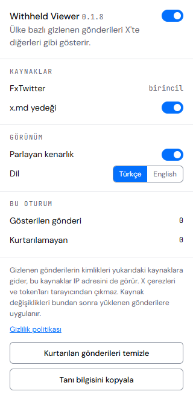
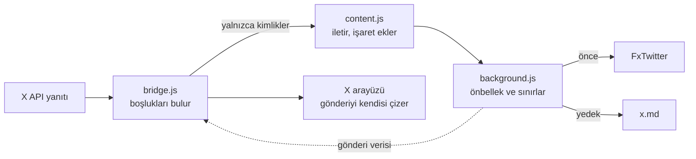

<div align="center">


# X Country Withheld Viewer

X'te ülke bazlı gizlenen herkese açık gönderileri ve hesapları,<br />
X'in kendi arayüzünde normal bir gönderi gibi gösteren tarayıcı eklentisi.

[Son sürümü indir](https://github.com/yusufky63/x-country-withheld-viewer/releases/latest) · [Kurulum](#kurulum) · [Nasıl çalışır](#nasıl-çalışır) · [SSS](#sık-sorulan-sorular)

</div>

<br />

<p align="center">
  
</p>
<p align="center"><sub>Temsili görünüm. Hesap ve metin örnektir.</sub></p>

## Ne yapar

- **Gizlenen gönderileri yerinde açar.** Gönderi, yanıt ve alıntı olduğu yerde görünür. Ayrı bir kart ya da pencere yoktur.
- **Gizlenen hesapları açar.** Profil normal görünür, gönderiler de sekmelerine dolar.
- **Çizimi X'e bırakır.** Avatar, metin, fotoğraf, video ve butonlar X'in kendi bileşenleridir.
- **Türkçe gelir.** Arayüz varsayılan olarak Türkçedir, istersen İngilizceye geçebilirsin.
- **İki küçük işaret ekler.** Kurtarılan gönderinin kenarı hafifçe parlar, zaman damgasının yanında küçük bir göz durur. Gözün üzerine gelince ülke ve kaynak yazar.
- **Kurulum dışında bir şey istemez.** VPN, ücretli API ya da ek hesap gerekmez.

Hiçbir kaynakta bulunamayan gönderide X'in kendi uyarısı kalır, altına nedenini söyleyen tek satır eklenir.

## Kurulum

### Hazır sürümle

1. [Son sürümden](https://github.com/yusufky63/x-country-withheld-viewer/releases/latest) ZIP dosyasını indirip bir klasöre çıkar.
2. `chrome://extensions` ya da `edge://extensions` sayfasını aç ve **Geliştirici modu**nu etkinleştir.
3. **Paketlenmemiş öğe yükle** ile çıkardığın klasörü seç.
4. Açılan sekmede eklentinin ne yaptığını oku ve onay ver. Onay verene kadar eklenti kapalı kalır.
5. X sekmesini yenile.

Klasörü silme, tarayıcı eklentiyi her açılışta oradan yükler.

### Kullanıcı betiği olarak

Ayrı bir eklenti kurmak istemezsen aynı kod Tampermonkey ya da Violentmonkey ile de çalışır.

1. Tarayıcına Tampermonkey ya da Violentmonkey kur. Chromium tabanlı tarayıcılarda Tampermonkey için eklentiler sayfasında **Geliştirici modu**nu ya da eklentinin ayrıntılarındaki **Kullanıcı betiklerine izin ver** ayarını aç.
2. [Betiği kur](https://github.com/yusufky63/x-country-withheld-viewer/releases/latest/download/x-country-withheld-viewer.user.js) bağlantısını aç, yönetici kurulum ekranını gösterir.
3. X sekmesini yenile.

Yeni sürümler yönetici tarafından otomatik alınır. Eklentiyle farkları:

- Ayarlar açılır pencere yerine yöneticinin menüsündedir. Sayaçlar menüde görünmez.
- Onay sorusu yoktur, betik kurulunca çalışır. Neyin nereye gittiği [gizlilik politikasında](PRIVACY.md) yazar.
- Kurtarılan içerik yalnızca sayfanın belleğinde tutulur, bu yüzden sayfa yenilenince kaynaklara yeniden sorulur.
- Eklenti ve betik birlikte kuruluysa önce yüklenen çalışır, diğeri devreye girmez. Hangisinin çalıştığı konsolda yazar.
- Tampermonkey betiği X'in kodu başladıktan sonra çalıştırabilir. X'in ilk isteği kaçarsa bu konsola yazılır, gizlenen profil ya da gönderi sayfası da bir kez `/explore` üzerinden geçip geri döner.

Betik Firefox'u da hedefler, ama bu tarayıcıda henüz denenmedi. Neyin denendiği [Durum](#durum) bölümünde yazar.

### Kaynaktan

Node 20 veya üstü ve pnpm gerekir.

```bash
pnpm install
pnpm build
```

Ardından yukarıdaki adımlarla `dist` klasörünü yükle. Yeniden derleyince eklentiler sayfasında eklentinin **Yeniden yükle** düğmesine basman gerekir, çünkü tarayıcı o zamana kadar eski derlemeyi çalıştırır. Hangi sürümün çalıştığı açılır pencerede yazar.

### Desteklenen tarayıcılar

Eklenti tarayıcının içinde çalıştığı için işletim sistemine bağlı değildir. Chrome, Edge ve Brave gibi Chromium tabanlı tarayıcılarda sürüm 111 ve üstünü hedefler. Şimdiye kadar yalnızca Windows'ta çalıştırıldı. Firefox ve Safari desteklenmiyor, ayrı uyarlama ister.

## Ayarlar

Araç çubuğundaki simgeye tıklayınca açılır. Değişiklikler kaydedilir. Henüz onay vermediysen burada önce onay sorusu görünür.

<table>
<tr>
<td width="260" valign="top">
<picture>
  <source media="(prefers-color-scheme: dark)" srcset="docs/assets/popup-koyu.png" />
  
</picture>
</td>
<td valign="top">

| Ayar | Ne yapar |
| --- | --- |
| Ana anahtar | Kapalıyken hiçbir kaynağa istek gitmez, tanı bilgisi tutulmaz, X olduğu gibi kalır. |
| x.md yedeği | FxTwitter sonuç vermezse `x.md` de sorulur. |
| Parlayan kenarlık | Kenar parlamasını açar, kapatır. Göz işareti kalır. Hemen uygulanır. |
| Dil | Türkçe ya da English. Varsayılan Türkçedir, tarayıcının diline bakılmaz. Hemen uygulanır. |
| Kurtarılan gönderileri temizle | Önbelleği ve oturum sayaçlarını temizler. |
| Tanı bilgisini kopyala | Sorun bildirmek için teknik özeti panoya kopyalar. |

</td>
</tr>
</table>

## Nasıl çalışır

X sayfası verisini kendi API'sinden alır. Gizlenen bir gönderi için yanıtta gönderi yerine bir uyarı gelir. Eklenti bu boşluğu X'in kodu yanıtı okumadan önce doldurur, X de gönderiyi her zamanki bileşenleriyle çizer.



Bir sorun olursa yanıt olduğu gibi bırakılır, yani X çalışmaya devam eder.

<details>
<summary><strong>Teknik ayrıntılar: X'in iki istemcisi</strong></summary>

<br />

X aynı anda iki farklı istemci kullanıyor. Eklenti ikisini de tanır.

| | Eski istemci | Relay istemcisi (`x-web`) |
| --- | --- | --- |
| Görüldüğü yer | Oturum açık sayfalar | Oturumsuz sayfalar |
| Uç nokta | `x.com/i/api/graphql/...` | `api.x.com/graphql/...` |
| İstek yöntemi | XHR | `fetch` |
| Gizlenen gönderi | `TweetTombstone` | `result` alanı olmayan `{ id, rest_id }` |
| Gizlenen hesap | `profile_bio.withheld_in_countries`, boş `core.name`, `legacy` yok | `legacy.withheld_in_countries`, `core.name` yok |
| Okunan gönderi alanları | `legacy.*` | `details`, `counts`, `media_entities2` |
| Akış girdileri | `entryId`, `itemContent` | `entry_id`, `content.content` |

Kurtarılan gönderi iki şemayı da dolduran tek bir nesnedir, her istemci yalnızca kendi alanlarını okur. Akışlar bunun için fazla farklı olduğundan istemciye göre ayrı üretilir. Yapılar X'in herkese açık JS paketlerinden ve gerçek yanıtlardan çıkarıldı.

</details>

## Gizlilik ve güvenlik

Ayrıntılar [gizlilik politikasındadır](PRIVACY.md).

- **Onay:** Eklenti ilk açılışta ne yaptığını anlatır ve onayını ister. Onay verene kadar kaynaklara istek gitmez, hiçbir şey saklanmaz. Yanıtını açılır pencereden değiştirebilirsin.
- **Dışarı çıkan:** Yalnızca gönderi kimlikleri, kullanıcı kimlikleri ve herkese açık kullanıcı adları. X çerezleri, token'ları ve istek başlıkları okunmaz, saklanmaz, gönderilmez.
- **Kaynakların gördüğü:** İstekler çerezsiz ve yönlendirme bilgisi olmadan gider, ama kaynaklar IP adresini görür.
- **İzinler:** Yalnızca `storage` ve iki kaynak adresi. `cookies`, `webRequest`, `debugger` ya da `proxy` istenmez.
- **Saklama:** Kurtarılan içerik `chrome.storage.session` içinde, yani yalnızca bellekte tutulur ve tarayıcı kapanınca silinir.
- **Güvenilmeyen veri:** Kaynak yanıtları doğrulanır. Medya yalnızca X'in CDN'lerinden kabul edilir, bağlantılar `http` veya `https` olmalıdır, HTML hiçbir zaman sayfaya eklenmez.
- **Sayfa içi mesajlar:** `window.postMessage` sayfadaki başka betikler tarafından taklit edilebilir, bu yüzden gelen her mesaj doğrulanır ve kimliği doğrulanmış kanal sayılmaz.
- **Korumalı hesaplar:** Bir kaynak metnini döndürse bile korumalı hesabın gönderisi gösterilmez.
- **Tanı bilgisi:** Sayfa yolları, istek adları, yanıt şekilleri ve sayılardan oluşur, bellekte kalır ve ancak sen kopyalarsan dışarı çıkar.

## Durum

| Kontrol | Nasıl denendi | Sonuç |
| --- | --- | --- |
| Gizlenen hesabın profili | Gerçek oturum açık sayfa, Edge'de yüklü eklenti | X çizdi |
| Gizlenen hesabın Tümü görünümü | Gerçek oturum açık sayfa, kullanıcı bildirimi | X çizdi |
| Gizlenen yanıt: metin, fotoğraf, video, link, mavi tik | Gerçek oturumsuz sayfa, eklenti kodu sayfaya eklenerek | X çizdi |
| Gizlenen hesabın gönderi sekmesi, alıntıyla | Gerçek oturumsuz sayfa, eklenti kodu sayfaya eklenerek | X çizdi |
| Göz işareti ve kenarlık biçimi | Gerçek oturumsuz sayfa, açık ve koyu tema, işaretler elle eklenerek | Görünüyor |
| `fetch` ve tüm XHR kullanım biçimleri | Eklentinin yüklü olduğu gerçek Chromium, taklit sayfa | Geçti |
| XHR dinleyen iki başka eklentiyle birlikte | Gerçek Chromium, onların kancaları yüklü, taklit sayfa | Geçti |
| Canlı kaynaklar | Service worker'dan FxTwitter çağrıları | Geçti |
| Onay adımı: kurulumda açılan sekme, kabul, ret ve onay yokken kapalı kalma | Gerçek Chromium, taklit sayfa | Geçti |
| Chrome Web Store incelemesi | Yok | **Henüz başvurulmadı** |
| Oturum açık varsayılan Gönderiler, Yanıtlar, Yeniden gönderiler ve Medya | X'in paketinden okunan şekle göre testler | **Gerçek sayfada henüz görülmedi** |
| Oturum açık tek gönderi değişimi ve yanıt doldurma | Gerçek yanıtın şekline göre testler | **Gerçek sayfada henüz görülmedi** |
| Kullanıcı betiği: yanıt yakalama, işaret, menü, eklentiyle birlikte kurulum | Gerçek Chromium, yönetici taklidi, taklit sayfa | Geçti |
| Kullanıcı betiği: gerçek Tampermonkey ve X sayfası | Edge, Tampermonkey 5.5.1, oturum açık profil, kullanıcı bildirimi | Çalıştı |
| Kullanıcı betiği: X'in isteğinden sonra başlayınca gönderi sayfası | Yönetici taklidi, taklit sayfa | Geçti, **gerçek sayfada henüz görülmedi** |
| Kullanıcı betiği: Violentmonkey ve Firefox | Yok | **Henüz denenmedi** |
| macOS ve Linux | İşletim sistemine bağlı kod yok | **Henüz çalıştırılmadı** |

## Bilinen sınırlar

- Kaynak yalnızca hâlâ erişebildiğini döndürebilir. Hiçbir kaynakta olmayan gönderi gösterilemez.
- Beğeni, yeniden paylaşım ve yanıt butonları X'e normal istek atar. X bunları gizlenen gönderide reddedebilir.
- Anketler X'in anket kartı yerine düz metin olarak görünür, çünkü kaynaklar kart için gereken veriyi vermiyor.
- Oturumsuzken X normal hesapların gönderi sekmesini göstermez. Gizlenen hesabın sekmesi kaynaktan dolduğu için burada normal bir profilden fazlası görünür.
- Relay istemcisinde yalnızca gönderi sekmesi dolar. Diğer sekmelerin yanıt yolu henüz bilinmiyor.
- Medya sekmeleri düz gönderi listesi olarak dolar. X'in ızgara görünümünü koruyup korumadığı denenmedi.
- Oturumsuz doğrudan açılan gizli sayfa X'in sunucusunda çizilir. Eklenti sekmeyi bir kez `/explore` üzerinden geçirip geri getirir, bu yüzden biraz daha uzun sürer.
- X'in yanıtı kaynakları en fazla 4 saniye bekler. Daha geç gelen sonuç için o an X'in uyarısı görünür, sonuç önbelleğe alınır ve sonraki açılışta kullanılır. Bir kez dolan hesap sayfa yenilenene kadar bellekte kalır, X aynı hesabı sonraki yanıtlarda yeniden gönderse de uyarıya dönmez.
- Aynı hesap için kaynaklar bazen 200, bazen 404 dönebilir. Profil sorguları bu yüzden sayısal kimlikle yapılır. `x.md` verisini FxTwitter'dan alabildiği için tam bağımsız bir yedek değildir.

## Kaynak sınırları

İki kaynak da ücretsizdir, API anahtarı istemez ve IP başına sınır uygular.

| Kaynak | Sınır | Dayanak |
| --- | --- | --- |
| FxTwitter | Dakikada 1.000 istek | Kendi belgesi |
| x.md | Dakikada 600 istek | Yanıt başlıkları |

Eklenti aynı anda en fazla 2 istek gönderir ve sonuçları 30 dakikaya kadar önbellekte tutar. Sınıra takılırsa o kaynağa, kaynağın istediği süre kadar ya da 60 saniye istek atmaz.

## X değişirse

X içeriği kendisi çizdiği için görsel tasarım değişikliklerinde genelde güncelleme gerekmez. En kötü ihtimalle göz ve kenarlık görünmez olur, çünkü bunlar `main`, `article` ve `/status/<id>` bağlantılarına dayanır. İstekler adlarıyla tanındığı için değişen `queryId` değerleri de sorun olmaz.

Şu durumlarda güncelleme gerekir:

| Değişiklik | Sonucu | Düzeltilecek yer |
| --- | --- | --- |
| API yanıtındaki gizleme alanları | Gönderi ya da profil gizli kalır | `src/core/profile.ts`, `src/core/withheld-detector.ts`, `src/core/synthesize.ts` |
| İstek adları ya da akış yolu | Bir profil sekmesi boş kalır | `src/core/timeline.ts` |
| Oturum açık hesapların Relay istemcisine geçmesi | Gönderiler dışındaki sekmeler boş kalır | `src/core/timeline.ts` |
| FxTwitter ya da x.md API'leri | Kurtarma durur | `src/providers/` |

Bunların hiçbirinde X bozulmamalı, çünkü eşleşmeyen her şey X'in yanıtını olduğu gibi bırakır. Ne olduğunu görmek için açılır penceredeki **Tanı bilgisini kopyala** düğmesini ya da konsoldaki `[X Withheld Viewer]` satırlarını kullanabilirsin.

## Sık sorulan sorular

**VPN ya da ücretli API gerekir mi?**
Hayır.

**Hangi gönderileri açmaya çalışır?**
X'in gizlendi olarak işaretlediklerini ve oturumsuzken X'in boş döndürdüklerini. Silinmiş gönderiler ve korumalı hesaplar X'in gösterdiği gibi kalır.

**Parlayan kenar ve göz ne anlama geliyor?**
Bu gönderinin başka bir kaynaktan geldiğini. Gözün üzerine gelince ülke ve kaynak yazar. Kurtarılan profilde göz, kullanıcı adının yanında durur.

**Kenar parlamasını kaldırabilir miyim?**
Evet. Açılır pencerede **Parlayan kenarlık** anahtarını kapat. Hemen uygulanır, göz işareti kalır.

**Eklenti İngilizce kullanılabilir mi?**
Evet. Açılır pencerede **Dil** bölümünden English'i seç. Açılır pencere, göz işaretinin açıklaması ve uyarı notları hemen değişir. Geri kalan her şeyi X kendi dilinde çizer.

**Eklentiyi kapatabilir miyim?**
Evet, açılır penceredeki ana anahtardan. Kapalıyken hiçbir kaynağa istek gitmez.

**Gizlenen gönderi ya da profil hâlâ açılmıyor, ne yapmalıyım?**
Açılır pencere onay soruyorsa önce onu yanıtla. Sonra eklentiler sayfasında eklentiyi yeniden yükle, açılır pencerede sürümü kontrol et ve X sekmesini yenile. Konsolda aynı sürümle `[X Withheld Viewer] ... active` satırı görünmeli. Bu satır yoksa eklenti sayfada çalışmıyor demektir. Varsa açılır pencereden **Tanı bilgisini kopyala** ile bilgiyi kopyalayıp sorun bildirirken ekle. Bu bilgide gönderi metni, çerez ya da istek başlığı yoktur.

## Geliştirme

| Komut | Ne yapar |
| --- | --- |
| `pnpm dev` | Değişiklikleri izleyerek derler |
| `pnpm build` | Eklenti için `dist`, kullanıcı betiği için `dist-userscript` klasörünü üretir |
| `pnpm serve:userscript` | Derlenen betiği yerelde sunar, böylece yöneticiyle kurulup denenebilir |
| `pnpm check` | Typecheck, lint, birim testleri ve derleme |
| `pnpm test:e2e` | Eklentiyi ve betiği gerçek Chromium'da çalıştırır, canlı kaynakları çağırır |
| `pnpm icons` | Simgeleri yeniden üretir |
| `pnpm package` | Derler ve yüklenecek ZIP dosyasını repo köküne yazar |
| `pnpm store:assets` | Derler, mağaza görsellerini ve README'deki açılır pencere görsellerini yeniden üretir |
| `node tools/probe.mjs <postId> [kökPostId] [kullanıcıAdı]` | Kaynakların bir gönderiyi döndürüp döndürmediğini gösterir |

Tarayıcı testleri için `pnpm exec playwright install chromium` çalıştır ya da kurulu bir Chromium için `CHROMIUM_PATH` ortam değişkenini ayarla.

Test verileri gerçek yanıtların yapısını korur, hesaplar ve metinler örnektir. Değişiklik geçmişi [CHANGELOG.md](CHANGELOG.md) dosyasındadır.

## Yasal not

Gizleme kararları, ilgili ülkedeki yasal taleplere dayanır. Bu eklentiyi kullanmadan önce sana uygulanan kuralları kontrol et, sorumluluk kullanıcıya aittir. Eklenti, X, FxTwitter ya da x.md ile bağlantılı değildir.

## Lisans

[MIT](LICENSE)
